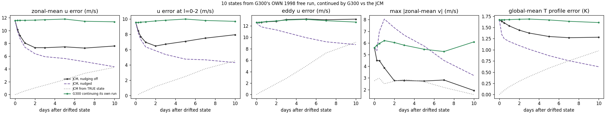
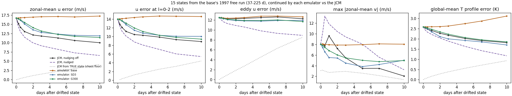
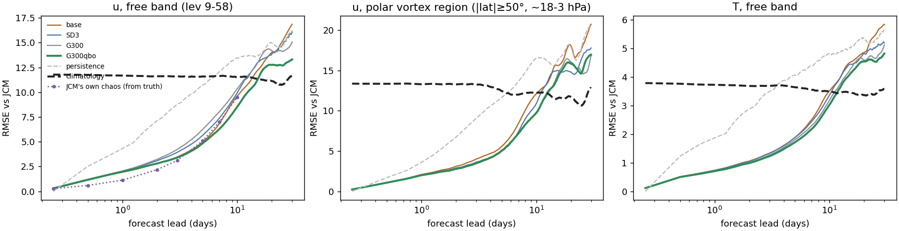
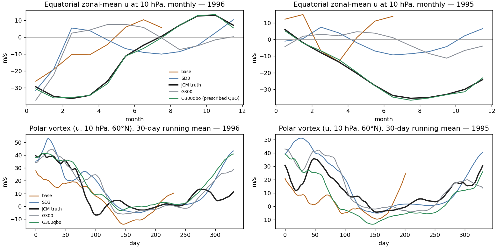
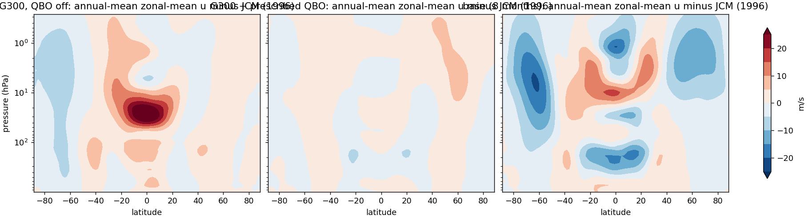

# Stabilizing the 25M emulator by fine-tuning: DAgger, rollout loss, masked dycore term, T anchor, prescribed QBO

## Question

Starting from epoch=123, which fine-tuning ingredients make the free emulator stable and balanced for 1-2 years without losing variance?

## Design

Fixed harness (eff. batch 36, archive 1997-2008, warmup). Selection set 1998x4 + 2009 IC0, test 1996/1995 x 4 ICs; bad = died OR Tprof>4K OR bias>15 m/s; strict selection rule; consolidated ranking over 671 runs.

## Results

See [`RESULTS.md`](RESULTS.md). This folder predates the preregistration schema (`retrofitted: true`): it was recorded from the cluster logs and write-ups, not preregistered. Provenance: every number cites a file on the Voltage Park box; see [`INVENTORY`](../../plans/jcm-emulator-survey/INVENTORY.md). Withdrawn claims: [`RETRACTIONS`](../../plans/jcm-emulator-survey/RETRACTIONS.md).

## Status

Generated from frontmatter. Do not hand edit.
