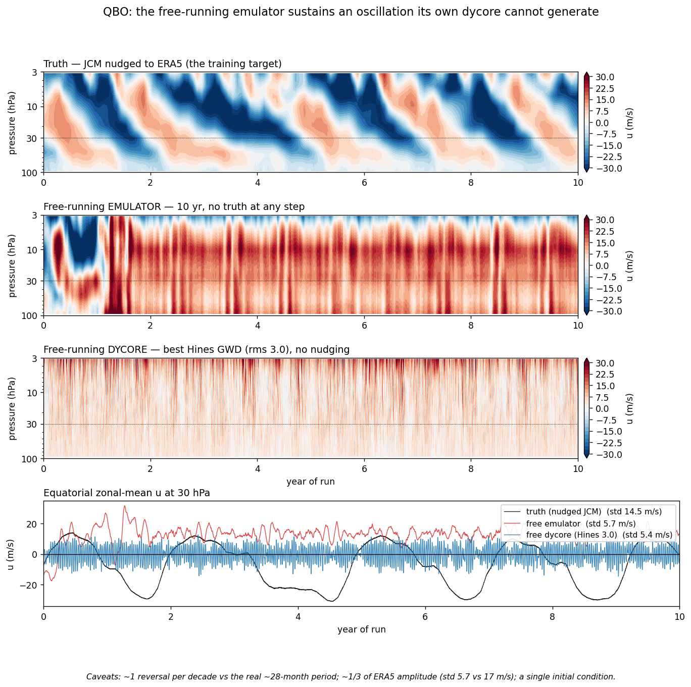

# PARADIS 25M fully free (no prescription, no QBO nudge): 5-yr, 10-yr climate, 12-yr scale-up

## Question

Can the network learn what prescription and the QBO nudge supplied, so that a deployable emulator needs no truth at any step?

## Design

config_jcm_free.yaml (1990-94) and config_jcm_free_big_fast.yaml (1997-2008, 60k steps x eff. batch 36 -> epoch=123, the base for all fine-tuning). Fixed gate, 1996 x 4 ICs; 10-yr free climate run; filter transfer test.

## Results

See [`RESULTS.md`](RESULTS.md). This folder predates the preregistration schema (`retrofitted: true`): it was recorded from the cluster logs and write-ups, not preregistered. Provenance: every number cites a file on the Voltage Park box; see [`INVENTORY`](../../plans/jcm-emulator-survey/INVENTORY.md). Withdrawn claims: [`RETRACTIONS`](../../plans/jcm-emulator-survey/RETRACTIONS.md).

## Status

Generated from frontmatter. Do not hand edit.
